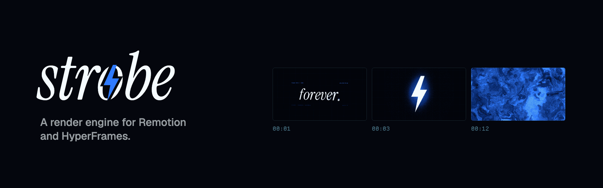
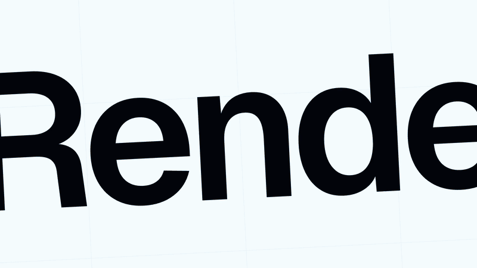

<h1 align="center">
  
</h1>

<p align="center">
  <b>Your Remotion and HyperFrames projects, rendered 2.4× to 5.2× faster.<br>You change no code.</b>
</p>

<p align="center">
  
  
  
  
</p>

<br>

With Opus 5.5, we all make motion graphics with code now. The agent writes the scene in minutes. Then every change waits on a render, and the render is slow.

I built Strobe to change that. Strobe reads the same Remotion or HyperFrames project and writes the same MP4. It keeps each frame on the GPU, from the paint to the encoder.

```sh
vrf render ./launch-film -o launch.mp4
```

<p align="center">
  
</p>

> [!NOTE]
> The project is called Strobe. The binary is still called `vrf` until the rename lands.

## The numbers

<p align="center">
  <picture>
    <source media="(prefers-color-scheme: dark)" srcset="assets/readme/speed-dark.png">
    
  </picture>
</p>

I rendered seven public launch videos, each one on the framework it was built for.

| Launch video | Rival | Rival time | Strobe time | Speedup |
|---|---|---:|---:|---:|
| `github-unwrapped` | Remotion 4.0.539 | 44.28 s | 8.49 s | **5.2×** |
| `transitions-video` | Remotion 4.0.539 | 13.79 s | 3.01 s | **4.6×** |
| `spacex-launch` | HyperFrames 0.8.216 | 15.90 s | 4.46 s | **3.6×** |
| `figma-launch` | HyperFrames 0.8.216 | 30.69 s | 8.71 s | **3.5×** |
| `heygen-stripe` | HyperFrames 0.8.216 | 23.02 s | 7.63 s | **3.0×** |
| `hyperframes-launch` | HyperFrames 0.8.216 | 26.18 s | 9.25 s | **2.8×** |
| `4-0-trailer` | Remotion 4.0.539 | 38.94 s | 16.28 s | **2.4×** |

Each time is wall clock, from the command to the finished file. The machine is an Apple M4 Mac mini with 10 cores and 16 GiB of memory. The rival times are the median of five runs. The Strobe times on the four HyperFrames videos come from one run each.

Seven videos are a start, not proof. The repository also holds 26 synthetic projects. Each one pushes on one axis: canvas, text, images, 4K, WebGL, embedded video and more. If Strobe is slower on your project, I want to see that project.

<details>
<summary><b>Run the benchmark on your machine</b></summary>
<br>

```sh
bench/fetch-external.sh
cargo build --release -p vrf-cli -p vrf-bench
target/release/vrf-bench run --engine vrf,remotion,hyperframes --corpus all --runs 5
```

The bench refuses to start while the load average is 2 or higher. It waits up to 600 seconds for the machine to go idle, so close other apps first.

</details>

## The frame never leaves the GPU

<p align="center">
  <picture>
    <source media="(prefers-color-scheme: dark)" srcset="assets/readme/architecture-dark.png">
    
  </picture>
</p>

Remotion and HyperFrames drive headless Chrome over DevTools. For every frame, they ask Chrome for a screenshot. Chrome reads the pixels back from the GPU and compresses them on the CPU. FFmpeg then decompresses the image and encodes it again. At 30 fps, a one-minute video makes that trip 1,800 times.

Strobe embeds CEF 156, the Chromium Embedded Framework, and renders off screen. The painted frame arrives as an IOSurface. A wgpu compute shader converts it to NV12, and VideoToolbox encodes it. On macOS, no frame comes back to the CPU. On Windows, the same path runs through D3D12 and NVENC.

The GPU path is the big win. These smaller parts add up too:

- **One begin frame per seek.** Strobe drives the compositor in lock step. Each seek gets exactly one begin frame, so no frame is dropped or painted twice.
- **A virtual clock.** A small script replaces `Date.now`, `performance.now`, `requestAnimationFrame` and `document.timeline`. Your animation sees the frame time, not the wall time.
- **No paint for frames that do not change.** If the page reports no damage, Strobe repeats the last frame. A title card that holds still costs almost no work.
- **Parallel views.** Strobe measures your machine and splits the frames across several views.
- **A second H.264 lane on macOS.** On the M4 Mac mini, VideoToolbox recommends one encoder session. Strobe runs libx264 beside it on the spare cores.
- **A warm daemon.** `vrf daemon` keeps CEF loaded between renders, so a queue of renders pays the startup cost once.

Stock CEF cannot decode H.264 in a `<video>` element, so Strobe decodes embedded video with VideoToolbox. If a clip does not match the framework's own decoder exactly, Strobe falls back to that decoder for the clip.

### Fast is worthless if the pixels are wrong

Strobe has two raster modes, and you pick the trade.

`--mode reference` rasterises on the CPU. It gives the pixels of the `chrome-headless-shell` that Remotion ships. Remotion projects use this mode by default.

`--mode fast` rasterises on the GPU, as HyperFrames does. It is up to 30% quicker on pages where raster is the bottleneck. Blended fills and gradients can land one level away from the Remotion pixels. HyperFrames projects use this mode by default.

## Build it

There are no release binaries yet, so you build from source. You need these tools:

- Rust 1.99.1. The `rust-toolchain.toml` file pins the version.
- cmake and ninja, to build CEF.
- Node, plus the dependencies of your project.
- x264 for the second H.264 lane. On macOS, run `brew install x264`. If the library is not at `/opt/homebrew/lib/libx264.dylib`, set `VRF_LIBX264` to its path.

```sh
git clone https://github.com/hridaya423/strobe
cd strobe
cargo build --release -p vrf-cli
```

The binary is `target/release/vrf`.

## Render a project

```sh
vrf render ./my-remotion-app --composition Main -o out.mp4
vrf render ./my-remotion-app --composition Main -o out.mp4 --props '{"title":"Hello"}'
vrf render ./my-hyperframes-video -o out.mov --codec prores --fps 60
vrf render ./my-remotion-app --composition Main -o clip.mp4 --frames 0-89
```

For a queue of renders, start the daemon once:

```sh
vrf daemon &
vrf render ./a --composition Main -o a.mp4
vrf render ./b --composition Main -o b.mp4
```

Projects that use WebGL render on SwiftShader, and they need a daemon of their own. Start it with `VRF_SOFTWARE_WEBGL=1 vrf daemon`.

<details>
<summary><b>All the flags</b></summary>
<br>

| Flag | What it does |
|---|---|
| `--composition` | Selects the Remotion composition. A Remotion project requires it. |
| `--codec` | Selects `h264` (the default), `hevc` or `prores`. |
| `--mode` | Selects the `reference` or `fast` raster mode. |
| `--frames` | Renders one frame, or a range such as `0-89`. |
| `--props` | Passes input props as JSON, or as the path of a JSON file. |
| `--fps` | Sets the frame rate of a HyperFrames render. The default is 30. |
| `--offline` | Fails on any http(s) request that `vrf.lock.json` does not pin. |
| `--video` | Selects the decoder for embedded video: `native` (the default) or `remotion`. |
| `--views`, `--run` | Override the measured number of parallel views and the frames per view. |
| `--no-skip` | Renders every frame, including unchanged frames. |
| `--no-turbo` | Encodes H.264 on VideoToolbox alone. |
| `--no-daemon` | Renders in this process, even if a daemon runs. |
| `--no-audio` | Leaves the audio out of the file. |
| `--json` | Prints a JSON report instead of the summary line. |

`vrf render --help` lists every flag with its default.

</details>

## What does not work yet

I would rather you read this here than find it in production.

- **Linux.** Strobe runs on macOS and Windows. Linux is not done.
- **Text on Windows.** Windows draws glyph edges with DirectWrite, and macOS uses CoreText. On Windows, `github-unwrapped` and `4-0-trailer` do not pass the 10% fidelity margin yet. `progress.md` tracks the details.
- **Embedded video on Windows.** The `native` decoder uses VideoToolbox, so it works only on macOS.
- **Release builds.** There is no installer and no prebuilt binary.

## License

Strobe is available under the [Apache License 2.0](LICENSE).
