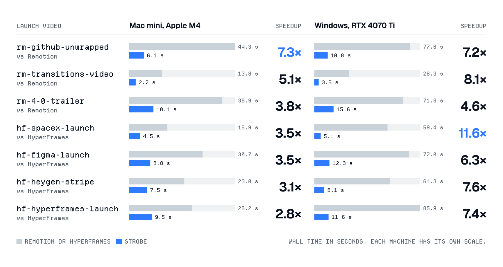
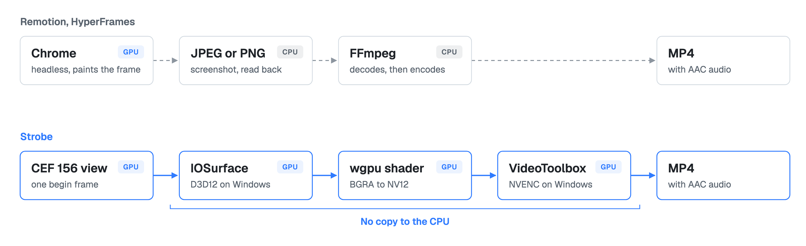

<div align="center">
  

  <p>
    
    
    
    
    
  </p>

  <p><b>Render your Remotion and HyperFrames projects up to 7.3× faster on a Mac and up to 11.6× faster on Windows.<br>You change no code.</b></p>

  <p>
    <a href="#install-it">Install</a>
    &nbsp;•&nbsp;
    <a href="#the-numbers">Benchmarks</a>
    &nbsp;•&nbsp;
    <a href="#the-frame-stays-on-the-gpu">How it works</a>
    &nbsp;•&nbsp;
    <a href="https://github.com/hridaya423/strobe/releases">Releases</a>
    &nbsp;•&nbsp;
    <a href="https://github.com/hridaya423/strobe/issues">Issues</a>
  </p>
</div>

With Opus 5.5, we all make motion graphics with code now. The agent writes the scene in minutes. Then every change waits on a render, and the render is slow.

I built Strobe to change that. Strobe reads the same Remotion or HyperFrames project and writes the same MP4. It keeps each frame on the GPU, from the paint to the encoder.

```sh
strobe render ./launch-film -o launch.mp4
```

<p align="center">
  
</p>

## The numbers

I rendered seven public launch videos, each one on the framework it was built for: Remotion 4.0.539 or HyperFrames 0.8.216. Each time is wall clock, from the command to the finished file.

<p align="center">
  <picture>
    <source media="(prefers-color-scheme: dark)" srcset="assets/readme/speed-dark.png">
    
  </picture>
</p>

The Mac is an Apple M4 Mac mini with 10 cores and 16 GiB of memory. There, the Remotion and HyperFrames times are the median of five runs, and the Strobe times are the median of three.

The Windows PC has an Intel i9-13900K and an NVIDIA RTX 4070 Ti. There, every engine had one warm-up run, then the median of three counts. Windows Defender real-time protection was off during the runs. Remotion and HyperFrames are much slower on this PC than on the Mac mini, so the Windows multiples are larger.

Strobe is not at its limit yet. The hardware encoder can take about 480 frames per second at 1080p on the Mac and about 495 on Windows. No launch video gets within 15% of that, because Chromium's page rendering is now the slow step.

Seven videos are a start, not proof. The repository also holds 26 synthetic projects. Each one pushes on one axis: canvas, text, images, 4K, WebGL, embedded video and more. If Strobe is slower on your project, I want to see that project.

<details>
<summary><b>Run the benchmark on your machine</b></summary>
<br>

```sh
bench/fetch-external.sh
cargo build --release -p vrf-cli -p vrf-bench
target/release/vrf-bench run --engine vrf,remotion,hyperframes --corpus all --runs 5
```

In the bench, `vrf` is the label for Strobe. The bench waits up to 600 seconds for an idle machine and refuses to start if the machine stays busy. On macOS, busy means a load average of 2 or higher. On Windows, which has no load average, the bench samples CPU use for 200 ms and counts the busy cores. Close other apps first.

</details>

## The frame stays on the GPU

<p align="center">
  <picture>
    <source media="(prefers-color-scheme: dark)" srcset="assets/readme/architecture-dark.png">
    
  </picture>
</p>

Remotion and HyperFrames drive headless Chrome over DevTools. For every frame, they ask Chrome for a screenshot. Chrome reads the pixels back from the GPU and compresses them on the CPU. FFmpeg then decompresses the image and encodes it again. At 30 fps, a one-minute video makes that trip 1,800 times.

Strobe embeds CEF 156, the Chromium Embedded Framework, and renders off screen. The painted frame arrives as an IOSurface. A wgpu compute shader converts it to NV12, and VideoToolbox encodes it. On that path, no frame comes back to the CPU.

On Windows, the frame arrives as a D3D12 texture. NVENC encodes it on an NVIDIA GPU. On an Intel GPU, Strobe falls back to D3D12 Video Encode, which does H.264 only. AMD GPUs are not tested yet.

The GPU path is the big win. These smaller parts add up too:

- **One begin frame per seek.** Strobe drives the compositor in lock step. Each seek gets exactly one begin frame, so no frame is dropped or painted twice.
- **A virtual clock.** A small script replaces `Date.now`, `performance.now`, `requestAnimationFrame` and `document.timeline`. Your animation sees the frame time, not the wall time.
- **No paint for frames that do not change.** If the page reports no damage, Strobe repeats the last frame. A title card that holds still costs almost no work.
- **Parallel views.** Strobe measures your machine and splits the frames across several views.
- **A second H.264 lane on macOS.** On the M4 Mac mini, VideoToolbox recommends one encoder session. If the pages deliver frames faster than 75% of VideoToolbox's rate, Strobe also runs libx264 on the spare cores. The frames for that lane do come back to the CPU.
- **A warm daemon.** `strobe daemon` keeps CEF loaded between renders, so a queue of renders pays the startup cost once.

Stock CEF cannot decode H.264 in a `<video>` element, so Strobe decodes embedded video itself: with VideoToolbox on macOS and with Media Foundation on Windows. If a clip does not match the framework's own decoder exactly, Strobe falls back to that decoder for the clip.

### Fast is worthless if the pixels are wrong

Strobe has two raster modes, and you pick the trade.

`--mode fast` rasterises on the GPU, as HyperFrames does, and is the default. It is up to 30% quicker on pages where raster is the bottleneck. On Remotion projects, blended fills and gradients can land one level away from Remotion's pixels, and edges drawn with `shape-rendering: crispEdges` come out anti-aliased. You see that only when you zoom in.

`--mode reference` rasterises on the CPU. It gives the exact pixels of the `chrome-headless-shell` that Remotion ships. On Windows it is the default for Remotion projects, because there GPU raster is slower: the 4.0 trailer takes 32 s on the GPU and 16 s on the CPU.

## Install it

Download the build for your machine from the [releases page](https://github.com/hridaya423/strobe/releases/latest).

macOS on Apple silicon:

```sh
curl -LO https://github.com/hridaya423/strobe/releases/latest/download/strobe-macos-arm64.tar.gz
tar xzf strobe-macos-arm64.tar.gz
ln -s "$PWD/strobe-macos-arm64/strobe" /usr/local/bin/strobe
```

The build is not signed yet. If you download it in a browser, macOS blocks it. To unblock it, run `xattr -dr com.apple.quarantine strobe-macos-arm64`.

Windows on x64: unzip `strobe-windows-x64.zip` and put the `strobe-windows-x64` folder on your `PATH`. Keep `strobe.exe` next to its DLLs.

Strobe renders your project with your project's own dependencies, so you need Node and a `node_modules` folder.

- **macOS:** for the second H.264 lane, run `brew install x264`. If the library is not at `/opt/homebrew/lib/libx264.dylib`, set `VRF_LIBX264` to its path.
- **Windows:** for full speed, you need an NVIDIA GPU for NVENC. An Intel GPU works through D3D12 Video Encode, for H.264 only.

<details>
<summary><b>Build from source</b></summary>
<br>

You need Rust 1.99.1, which `rust-toolchain.toml` pins, plus cmake and ninja to build CEF.

```sh
git clone https://github.com/hridaya423/strobe
cd strobe
cargo build --release -p vrf-cli
```

The binary is `target/release/strobe`.

</details>

## Render a project

```sh
strobe render ./my-remotion-app --composition Main -o out.mp4
strobe render ./my-remotion-app --composition Main -o out.mp4 --props '{"title":"Hello"}'
strobe render ./my-hyperframes-video -o out.mov --codec prores --fps 60
strobe render ./my-remotion-app --composition Main -o clip.mp4 --frames 0-89
```

For a queue of renders, start the daemon once:

```sh
strobe daemon &
strobe render ./a --composition Main -o a.mp4
strobe render ./b --composition Main -o b.mp4
```

A daemon keeps one raster mode, and WebGL on SwiftShader needs a daemon of its own. If a render needs a daemon that is not running, Strobe starts that daemon and waits for it.

<details>
<summary><b>All the flags</b></summary>
<br>

| Flag | What it does |
|---|---|
| `-o`, `--output` | Sets the output file. |
| `--composition` | Selects the Remotion composition. A Remotion project requires it. |
| `--codec` | Selects `h264` (the default), `hevc` or `prores`. |
| `--mode` | Selects the `fast` or `reference` raster mode. `fast` is the default, except for Remotion projects on Windows. |
| `--frames` | Renders one frame, or a range such as `0-89`. |
| `--props` | Passes input props as JSON, or as the path of a JSON file. |
| `--fps` | Sets the frame rate of a HyperFrames render. The default is 30. |
| `--entry` | Sets the Remotion file that calls `registerRoot`. Strobe finds it if you leave it out. |
| `--hyperframes` | Sets the path of the installed `hyperframes` package. Strobe looks in `node_modules` above the project if you leave it out. |
| `--timeout` | Sets the milliseconds before a `delayRender` that never clears fails the frame. The default is 30000. |
| `--offline` | Fails on any http(s) request that `vrf.lock.json` does not pin. |
| `--video` | Selects the decoder for embedded video: `native` (the default) or `remotion`. |
| `--views`, `--run` | Override the measured number of parallel views and the frames per view. |
| `--lead-in` | Sets the frames that a view paints and discards before its run. The default is 20. |
| `--no-skip` | Renders every frame, including unchanged frames. |
| `--no-turbo` | macOS only: encodes H.264 on VideoToolbox alone, without the libx264 lane. |
| `--encoder-sessions` | Windows only: sets the number of NVENC sessions that share the encoding. The default is 1. |
| `--no-daemon` | Renders in this process, even if a daemon runs. |
| `--no-audio` | Leaves the audio out of the file. |
| `--json` | Prints a JSON report instead of the summary line. |

`strobe render --help` lists every flag with its default.

</details>

## What does not work yet

I would rather you read this here than find it in production.

- **Linux.** Strobe runs on macOS and Windows. Linux is not done.
- **WebGL shaders on Windows.** Some shaders hash with `sin`, so their output depends on the GPU. Strobe runs WebGL on the same NVIDIA GPU as the encoder. HyperFrames runs it on the default adapter, which can be the Intel iGPU. On `hf-hyperframes-launch`, frames 625 to 660 differ from HyperFrames' own render for that reason.
- **HEVC and AV1 on NVENC.** H.264 has a 240 Mbps ceiling, so grainy footage keeps its detail. HEVC and AV1 have no ceiling yet, so they may starve grainy footage of bits. I have not tested that.

## License

Strobe is available under the [Apache License 2.0](LICENSE).
